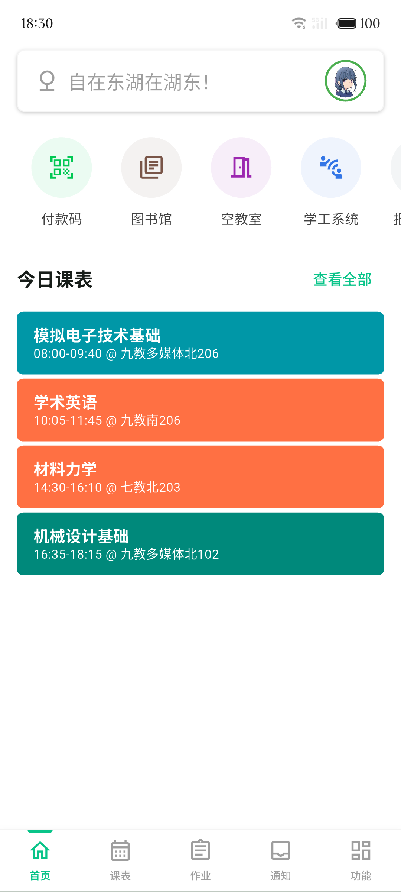
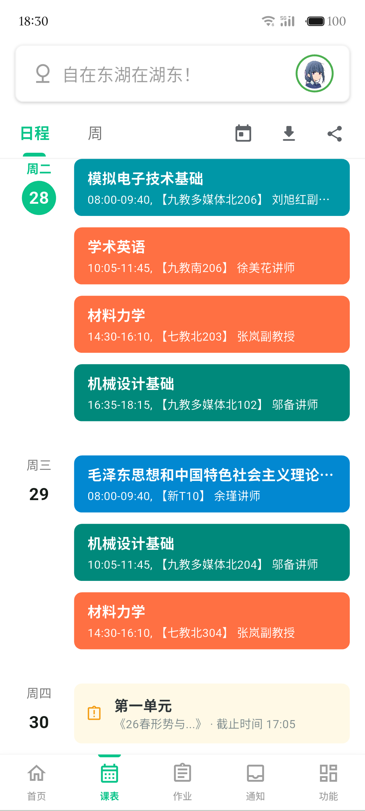
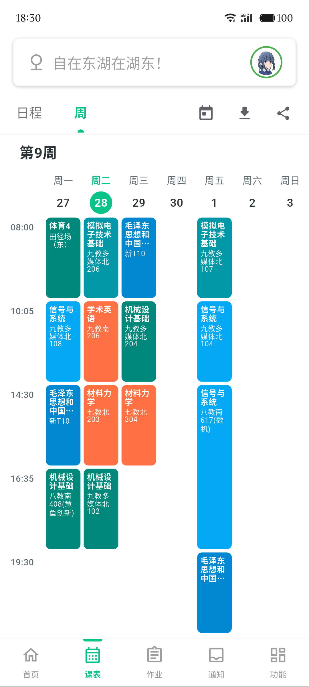
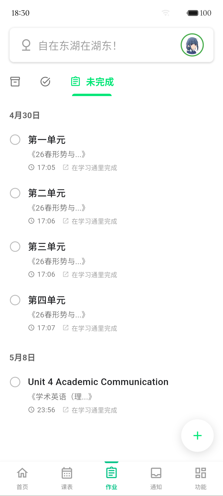
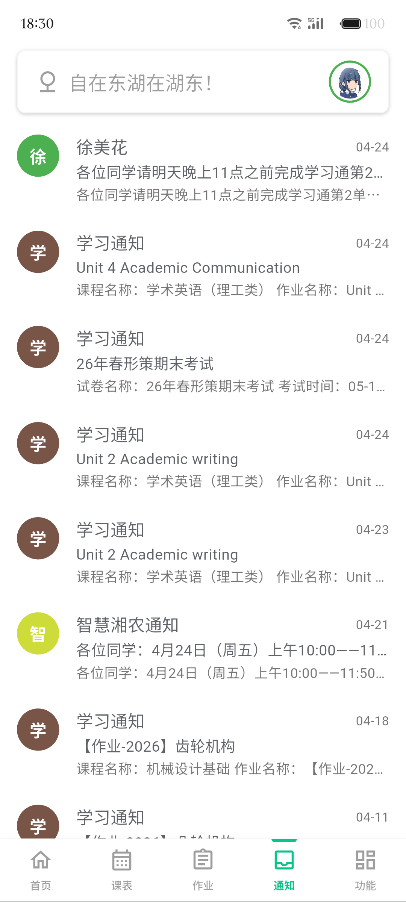
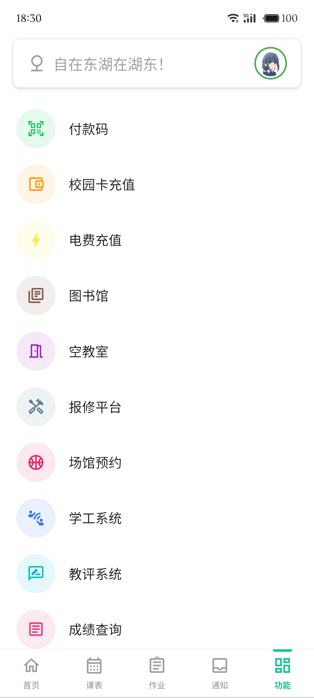
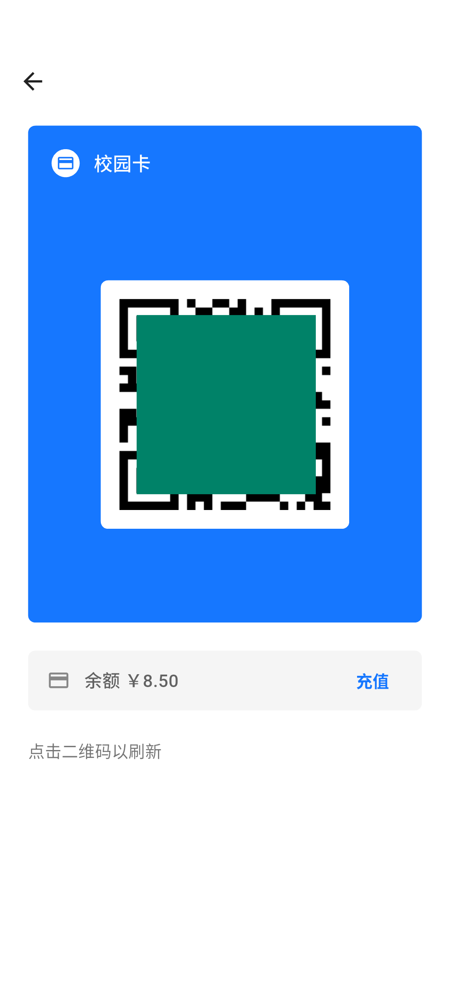

# 牛×5

湖南农业大学第三方客户端，基于 Flutter 开发，面向本科生的校园服务聚合应用。

## 下载

| 系统 | Release | 国内镜像 |
|------|---------|----------|
| Android | [GitHub Release](https://github.com/FmCoral/HUNAU-test/releases/latest) | [R2 CDN](https://apk.hunau.fmcoral.com/latest/app-release.apk) |
| iOS | 暂无 | 暂无 |

## 功能

### 原生实现
- **课程表**：周视图、自动同步、ICS 日历订阅、自定义课程颜色
- **日程首页**：今日课程、考试、作业、通知聚合
- **考试安排**
- **成绩查询**
- **作业列表**：超星平台同步，支持手动添加
- **通知公告**：学习通通知与课程实况通知
- **图书馆**：馆藏搜索、座位预约、研修间预约
- **空教室查询**
- **校园卡**：付款码、充值（微信 / 支付宝）、交易流水、扫码
- **电费充值**：支持两个宿舍同时充值
- **我的宿舍**：楼宇、单元、楼层、床号信息
- **请假申请**
- **阳光服务**：诉求提交与进度查询
- **学工问卷**
- **报修平台**
- **实时校车**：地图实时追踪
- **AI 助手**：对接校内 AI 中转服务
- **WebVPN 链接转换**
- **平板分屏**：大屏设备支持左右分屏浏览

### WebView 加载
- 学工系统
- 办事大厅
- 场馆预约
- 教评系统
- 更多小程序
- 长沙实时公交

## 多语言支持
简体中文 / 繁体中文（台湾）/ 繁体中文（香港）/ 英语 / 日语 / 法语 / 西班牙语 / 葡萄牙语 / 俄语

## 预览

| 首页 | 日程 | 课表 | 作业 |
| :---: | :---: | :---: | :---: |
|  |  |  |  |
| **通知** | **功能** | **付款码** |
|  |  |  |

## 反馈

- 应用内「帮助与反馈」页面
- GitHub Issues

## 致谢

本项目基于原作者 [SoilZhu](https://github.com/soilzhu) 的 ChillEast 二次开发，感谢原作者的开源工作。
